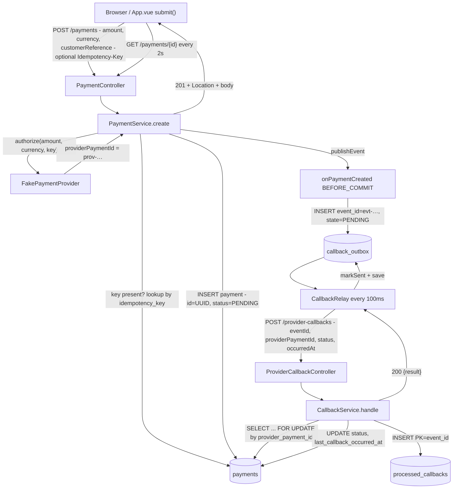

# Payment Inbox — presentation notes

A small payment service that shows the two hard parts of payment integrations:

- **Inbound idempotency** — a retried `POST /payments` must not charge twice.
- **Outbound reliability** — a provider callback must not be lost if the process dies.

Stack: Java 21, Spring Boot 3.3, Spring Data JPA, H2 (in-memory), Vue 3 + Vite, nginx, Docker Compose.

---

## Quick start

```bash
docker compose up --build
# UI:      http://localhost:3000
# API:     http://localhost:8080
# Swagger: http://localhost:8080/swagger-ui.html
```

Backend only, from IntelliJ: run `PaymentsApplication` (Temurin 21). Frontend only:
`cd frontend && npm ci && npm run dev` (Vite proxies `/payments` to `localhost:8080`).

---

## The whole flow



---

## The ids — who owns what

| Id | Created by | Where | Used for |
|---|---|---|---|
| `payment.id` (UUID) | us, `PaymentService.java:89` | `payments.id` | **the only id the frontend uses** |
| `providerPaymentId` (`prov-…`) | provider, `FakePaymentProvider.authorize:33` | `payments.provider_payment_id` (unique) | callback lookup |
| `eventId` (`evt-…`) | provider, `FakePaymentProvider.buildCallback:65` | `callback_outbox.event_id`, `processed_callbacks.event_id` (PK) | dedupe of callback retries |
| `Idempotency-Key` | caller | `payments.idempotency_key` (unique) | duplicate `POST /payments` |
| fingerprint (SHA-256) | us, `PaymentService.fingerprint:126` | `payments.idempotency_request_hash` | 409 on key reuse |

Rule of thumb: **the frontend speaks UUID, the provider speaks `prov-…`, the callback speaks `evt-…`.**

Why both `providerPaymentId` and `eventId`:

- `providerPaymentId` answers *"which payment?"* — stable across all events, used to find the row.
- `eventId` answers *"which notification?"* — unique per event, reused on retries, used to dedupe.

---

## Idempotency on create

Contract: optional `Idempotency-Key` header, 1–128 chars of `[A-Za-z0-9._:+/=-]`.

Fingerprint input is canonicalised so formatting differences don't matter:

```
amount.setScale(2).toPlainString() + "|" + currency.toUpperCase() + "|" + customerReference
```

`12.5 / eur` and `12.50 / EUR` produce the same hash.

| Situation | Result |
|---|---|
| no key | always creates a new payment |
| key, first time | `201`, payment created, provider called |
| key, same body | `201` + `Idempotency-Replayed: true`, **no provider call** |
| key, different body | `409 idempotency_key_reuse` |
| malformed key | `400 invalid_idempotency_key` |
| two simultaneous first attempts | unique index decides; loser catches `DataIntegrityViolationException`, re-reads the winner, replays |

### curl — create with idempotency

```bash
curl -i -X POST http://localhost:8080/payments \
  -H 'Content-Type: application/json' \
  -H 'Accept: application/json' \
  -H 'Idempotency-Key: checkout-1042' \
  -d '{"amount": 12.50, "currency": "EUR", "customerReference": "ORDER-1001"}'
```

```http
HTTP/1.1 201
Location: http://localhost:8080/payments/6f1c…-uuid
Content-Type: application/json

{
  "id": "6f1c…-uuid",
  "status": "PENDING",
  "providerStatus": null,
  "providerPaymentId": "prov-fc50de89-0caf-37f2-a398-0ab5c6f77045",
  "lastCallbackOccurredAt": null,
  "amount": 12.50,
  "currency": "EUR",
  "customerReference": "ORDER-1001"
}
```

### curl — replay the same request

```bash
curl -i -X POST http://localhost:8080/payments \
  -H 'Content-Type: application/json' \
  -H 'Idempotency-Key: checkout-1042' \
  -d '{"amount": 12.5, "currency": "eur", "customerReference": "ORDER-1001"}'
```

Same `201`, same `Location`, plus `Idempotency-Replayed: true`. Note `12.5`/`eur` still match — that's the canonicalisation.

### curl — reuse the key with different data

```bash
curl -i -X POST http://localhost:8080/payments \
  -H 'Content-Type: application/json' \
  -H 'Idempotency-Key: checkout-1042' \
  -d '{"amount": 13.00, "currency": "EUR", "customerReference": "ORDER-1001"}'
```

```http
HTTP/1.1 409
{"error":"idempotency_key_reuse","message":"…"}
```

### curl — read the payment

```bash
curl -s http://localhost:8080/payments/<id> | jq
```

After the callback lands (2–5 s), the same URL returns `"status": "SUCCEEDED"`, `"providerStatus": "CAPTURED"`, and a non-null `lastCallbackOccurredAt`.

---

## Inbound callbacks — row lock on the way in

`CallbackService.handle` is one `@Transactional` method. The payment row is locked with `PESSIMISTIC_WRITE` (`SELECT … FOR UPDATE`) for the whole read-check-write sequence, so two callbacks for the same payment serialise. That replaces `@Version` + a retry loop — no extra code, and the ordering rules always see a consistent state.

Rules, in order:

1. **Lookup** by `providerPaymentId` (locked). Unknown → `404 unknown_provider_payment`, never recorded.
2. **Dedupe** by `eventId` → `DUPLICATE`.
3. **Future-skew guard** (optional, off by default) → `400 invalid_occurred_at`.
4. **Record the event** — `INSERT processed_callbacks` with `event_id` as PK. A concurrent duplicate fails on the PK → `DUPLICATE`. Recorded even for `IGNORED`/`SUPPRESSED`.
5. **Watermark** — `occurredAt` must be strictly newer than `lastCallbackOccurredAt`, else `IGNORED`.
6. **Map status** — `AUTHORIZED→PENDING`, `CAPTURED→SUCCEEDED`, `DECLINED→FAILED`, anything else → `UNKNOWN`.
7. **Terminal guard** — a terminal payment is not regressed to `UNKNOWN`/`PENDING` → `SUPPRESSED`.
8. **Apply** → `APPLIED`.

All outcomes return `200 {"result":"…"}` except the 404/400 cases. The relay only cares that the POST didn't throw.

Optional HMAC: `X-Provider-Timestamp` + `X-Provider-Signature`, HMAC-SHA256 over `timestamp.body`, 5-minute window, constant-time compare, `401 invalid_signature`. Off by default.

### curl — manual callback (to exercise the multi-event path)

```bash
curl -i -X POST http://localhost:8080/provider-callbacks \
  -H 'Content-Type: application/json' \
  -d '{"eventId":"evt-manual-1","providerPaymentId":"prov-fc50de89-0caf-37f2-a398-0ab5c6f77045","status":"AUTHORIZED","occurredAt":"2026-11-11T10:00:00Z"}'
```

Send a second one with `"status":"CAPTURED"` and a newer `occurredAt` to see `APPLIED`. Send an older one to see `IGNORED`. Re-send the same `eventId` to see `DUPLICATE`.

---

## Outbound callbacks — outbox on the way out

The first design scheduled the fake callback after commit. That has a gap: die between commit and send and the callback is gone.

Current design:

1. `PaymentService` publishes `PaymentCreatedEvent` **inside** the payment transaction.
2. `FakePaymentProvider.onPaymentCreated` is a `@TransactionalEventListener(phase = BEFORE_COMMIT)` and writes a `callback_outbox` row in the **same transaction**. Either both commit or neither does.
3. `CallbackRelay` polls every 100 ms for up to 10 due `PENDING` rows (`state = PENDING AND next_attempt_at <= now`).
4. Sends over HTTP, then `markSent` → `SENT`, saved in its own transaction.
5. On failure: `attempts++`, `next_attempt_at = now + backoff` (500 ms doubling, capped at 30 s). After 5 attempts → `DEAD` (dead-letter).

Delivery is **at-least-once**: the relay can send, crash before marking `SENT`, and send again. Safe because the receiver dedupes on `eventId`.

The relay is a single instance here. Production would claim rows with `FOR UPDATE SKIP LOCKED` or use a real queue, and alert on rows going `DEAD`.

---

## Design decisions worth explaining

- **Programmatic `TransactionTemplate`, not `@Transactional` on `create`.** The `DataIntegrityViolationException` catch must run *after* the transaction ends, so it can re-read the committed winner. With `@Transactional`, the transaction would already be rollback-only and the recovery lookup would fail.
- **`saveAndFlush` on the payment.** Forces the `INSERT` so a duplicate idempotency key fails inside `createNew`, not as an opaque commit-time error.
- **Pessimistic row lock, not `@Version`.** Callbacks for one payment are rare and short; a retry loop on optimistic conflicts is code with no benefit here.
- **`BEFORE_COMMIT` outbox, not after-commit scheduling.** Removes the "committed payment, lost callback" window.
- **At-least-once + `eventId` dedupe, not exactly-once.** Exactly-once across a DB and HTTP doesn't exist; dedupe is the honest guarantee.
- **Fingerprint canonicalisation.** Makes `10.0`/`10.00` and `eur`/`EUR` the same request, so a retry after a formatting change still replays.

---

## Known gaps / follow-ups

Say these plainly — they read as scope boundaries, not bugs.

- **The bundled UI does not send `Idempotency-Key`.** The server contract is complete and tested; the demo UI is a non-idempotent caller. Fix is ~5 lines in `App.vue`: `crypto.randomUUID()` per submit intent, sent as the header, rotated when the form changes.
- **Keys never expire and are not scoped per caller.** Stripe prunes after 24 h and scopes per account; here a key is global and permanent.
- **`countByState` is declared but unused.** No metric or alert on `DEAD` rows yet.
- **Single relay instance.** Two instances would double-send (safe only because of `eventId` dedupe).
- **H2 in-memory.** Data is lost on restart; `ddl-auto: create-drop`.
- **The fake provider ignores `amount`/`currency`** — it only mints an id.
- **Terminal → terminal transitions are allowed.** A newer `DECLINED` can move `SUCCEEDED` → `FAILED`; only regression to `PENDING`/`UNKNOWN` is suppressed.
- **The fake sends one callback per payment** (default `CAPTURED`), so `AUTHORIZED` is only exercised by tests and manual curl.

---

## Q&A cheat sheet

**"Why is the idempotency key optional?"**
Because it's a caller contract. The server can't invent one — the caller's retry wouldn't know it. Without it, every request creates a payment, which is the documented behaviour.

**"What if two requests with the same key arrive at once?"**
Both miss the lookup, both call the provider (which derives the same `prov-…` id from the key), one `INSERT` wins on the unique index, the loser catches the violation, re-reads the winner and replays. One payment, one outbox row, one callback.

**"Why not just use `@Version`?"**
Optimistic locking would need a retry loop around the whole read-check-write. A row lock serialises the rare concurrent callbacks with no extra code.

**"What if the process dies mid-callback?"**
The outbox row is committed with the payment, so it survives. The relay re-sends; the receiver dedupes on `eventId`.

**"What if the callback is delivered twice?"**
`processed_callbacks` has `event_id` as PK. The second delivery is `DUPLICATE`, `200`, nothing changes.

**"What if callbacks arrive out of order?"**
`occurredAt` is compared to a watermark; anything not strictly newer is `IGNORED`. A late `AUTHORIZED` can't undo a `CAPTURED`.

**"Why does the payment start as `PENDING`?"**
That's the authorized-but-not-settled state. The fake provider skips straight to the final outcome in one callback.

**"Is this exactly-once?"**
No. At-least-once delivery plus idempotent processing. That's the strongest guarantee that survives a crash between the DB commit and the HTTP call.

**"What would you change for production?"**
Prune idempotency keys (24 h), scope them per caller, claim outbox rows with `SKIP LOCKED` or move to a broker, alert on `DEAD`, replace H2 with Postgres, and wire the UI's idempotency key.

---

## Test coverage

- `IdempotencyTest` — replay, 409 on reuse, malformed key, concurrent race.
- `ProviderCallbackRulesTest` — duplicate, watermark, terminal guard, unknown provider id, future skew.
- `CallbackDeadLetterIntegrationTest` — retries, backoff, `DEAD`.
- `FakeProviderIntegrationTest` — end-to-end create → callback → status.
- `CallbackRelayTest`, `FakeProviderTest` — unit level.
- `usePaymentPolling.spec.ts` — polling, terminal stop, stale-response guard.
